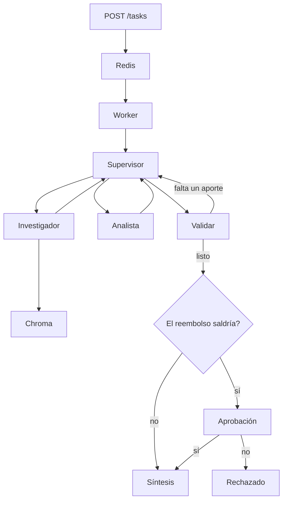

# Tienda Lumen

Un cliente pide devolver un juego. El sistema busca la política, compara el caso y, si el reembolso saldría, espera a que una persona lo apruebe.

Lumen vende el mismo juego en copia digital o en caja. Las dos traen un código de activación. Sin uso significa que ese código no se canjeó. Las reglas son estas:

- Devolución: hasta 10 días, hasta 20000 pesos, código sin canjear.
- Envío: gratis desde 15000 pesos; si no, 2500 pesos. Solo cuando el pedido incluye una caja.
- Garantía: 90 días por falla de fábrica. No cubre golpes ni humedad.

No hay una base de ventas. El monto, los días y el código vienen escritos en la solicitud.

## Cómo está armado



El supervisor reparte. El investigador lee las políticas en Chroma. El analista aplica los números con `validar_reembolso`. Si el veredicto empieza con "Corresponde", el grafo se pausa. `POST /tasks/{id}/approve` lo reanuda. Redis guarda el estado del job y el checkpoint, así que un reinicio no pierde la pausa. Cada corrida manda trazas a Phoenix.

## Levantar

Hace falta Docker y una clave de Gemini.

```bash
cp .env.example .env
# completar GEMINI_API_KEY
./run.sh
```

Eso es `docker compose up --build`. Quedan Redis en el puerto 6379, Phoenix en http://localhost:6006 y la API en http://localhost:8000. La documentación de los endpoints está en http://localhost:8000/docs.

Si Redis y Phoenix ya están corriendo en la máquina, sin Docker:

```bash
python -m uvicorn app.main:app --host 0.0.0.0 --port 8000
```

Python 3.12. Las dependencias están en `requirements.txt`. Los modelos y las URLs salen de `.env`. El ejemplo está en `.env.example`, sin claves.

## Una solicitud

```bash
curl -X POST localhost:8000/tasks \
  -H "Content-Type: application/json" \
  -d '{"query": "Pedrito compró el FIFA 26 en caja a 21000 pesos hace 9 días. El código de activación no se canjeó. ¿Corresponde la devolución?"}'

curl localhost:8000/tasks/<job_id>
```

El POST responde al instante con `PENDING` y un `job_id`. Después el estado pasa a `RUNNING` y termina en `DONE`, `FAILED` o `WAITING_APPROVAL`.

Si quedó en pausa:

```bash
curl -X POST localhost:8000/tasks/<job_id>/approve \
  -H "Content-Type: application/json" \
  -d '{"aprobado": false}'
```

`true` sigue a la síntesis. `false` deja `Reembolso rechazado por el revisor.`

## Cinco pruebas

Con la API ya levantada:

```bash
python scripts/pruebas.py
```

Manda cinco solicitudes juntas. El worker las toma de a una. La primera que se pausa se rechaza. La segunda se aprueba. Las trazas quedan en Phoenix, proyecto `tienda-lumen`, en los últimos 15 minutos de la corrida. En `screenshots/` están el volumen de trazas, la latencia con la serie P95 (el pico queda cerca de 21 s) y el costo, que Phoenix calcula bajo $0.01. Si Gemini responde 429, el job queda `FAILED`.
